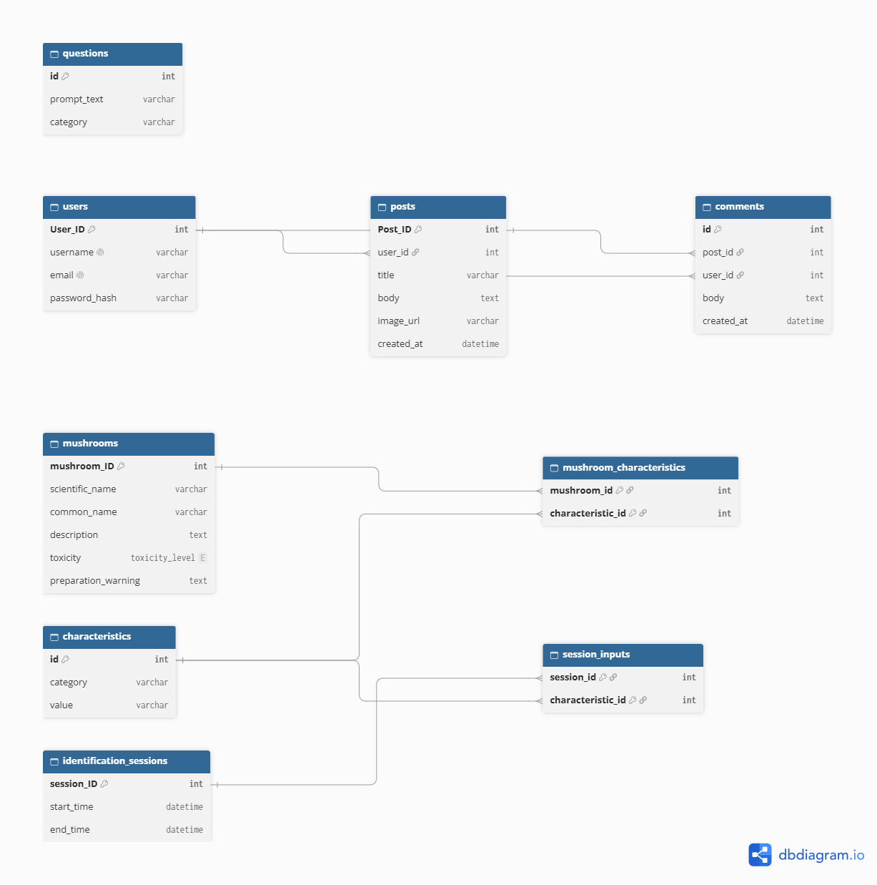

# Mushroom Identification App — Design Document

### Introduction
Have you ever found a mushroom in the woods but you had no clue what it was? Do you want to learn more about foraging mushrooms safely? Mushroom Finder is here to help:

- Helps identify mushroom through a few short questions
- Learn what mushrooms are poisonous
- Learn how to properly prep edible mushrooms for safe eating
- Learn what edible mushrooms are in your region
- Share pictures, ask/answer questions, and interact with other users in the Mushroom Finder community

The app is perfect for nature enthusiasts, foraging enthusiasts, and people interested in learning more about mushrooms in general.

### Logo

### Data Feeds
https://www.kaggle.com/datasets/benedictusjason/edible-and-poisonous-mushroom-classification
https://www.kaggle.com/datasets/mdhasanahmad/12-mushroom-species-dataset?resource=download
https://www.kaggle.com/datasets/benedictusjason/edible-and-poisonous-mushroom-classification

### Storyboard
https://canva.link/pbi6jcuj2u5rf6o

### Class diagram

### Function Requirements 
#### Requirement 100: Enter Mushroom Information
##### Scenario
As a user interested in mushrooms, I want to enter information about a mushroom I found so that the application can search for possible matching species.
##### Dependencies
A mushroom database is available and accessible.
##### Assumptions
Users can recognize some basic mushroom characteristics. Each initial question has predefined answer options.
###### Example
Given I found an interesting mushroom and the mushroom identification form is available

When I enter the following information:
- Color: Yellow, White
- Location: On wood, Western Ohio
- Top Shape: Rounded
- Width: Medium
- Height: Short
- Special features: Very textured
  
Then the application should accept my information and pull up something like the Fly Agaric Mushroom.

### Requirement 101: Ask Additional Questions To Clarify Species
#### Scenario
As a user, I want to answer additional questions when the application cannot sufficiently narrow down the mushroom type, so that I can receive more relevant results and I'm not forced to choose between two similar pictures of mushrooms.
#### Dependencies
The application has predefined follow-up questions and rules for selecting them.
#### Assumptions
The additional questions are only displayed when the initial answers are insufficient to distinguish between candidate species and bring up multiple results.
###### Example 1.1
Given I have completed the initial questions about an orange flat capped mushroom I found growing on a tree

When the application finds several possible matches, both poisonous and edible, that cannot be distinguished using my answers

Then the application should display additional questions about the mushroom:

###### Example 1.2
Given additional questions regarding gills (accompanied with diagrams), stem shape (accompanied with diagrams), and if its clustering are displayed

When I provide more details about the mushroom's gills, stem, and clustering (has gills, curved stem, and in a large cluster)

Then the application should update the possible matches based on my new answers and let me know its a toxic jack-o-lantern mushroom

Side note: if the identification function is still unable to narrow it down to a single result then it will guide user to avoid touching it and prompt them to take a picture and post it into the community to see if anyone there happens to know

### Requirement 102: Display Mushroom Safety Notices
#### Scenario
As a user, I want to see information about known mushroom toxicity and preparation risks so that I can better understand potential dangers and how to prep wild mushrooms to eat safely.
#### Dependencies
The database contains verified references about mushroom toxicity and documented preparation requirements.
#### Assumptions
Mushroom identification results do not establish that a collected specimen is safe to eat.
##### Example 1.1
Given a possible mushroom match is displayed, in this case its a destroying angel mushroom

When the database identifies that species as poisonous

Then the application should display a bold, prominent warning explaining that the species is highly toxic, should not be eaten, and have a link to call poison control/an ambulance if the user ate it before checking

##### Example 1.2
Given a possible mushroom match has a documented preparation requirement, in this case the user found some chicken in the woods

When user open its details on how to prep

Then the application should display that this specific mushroom must be cooked thoroughly and explain that if it isn't it can cause a lot of distress to the user's stomach.

### Requirement 103: Mushroom Community
#### Scenario
As a user interested in mushrooms, I want to interact with other users by sharing mushroom pictures, asking questions, and discussing mushroom species so that I can learn from their experiences and enjoy them
#### Dependencies
The application has a community discussion system where users can create posts, upload pictures, and respond to other users.
#### Assumptions
Users have an account to participate in the community. Community members can share their knowledge and experiences, but their responses are not guaranteed to be accurate.
###### Example 1.1
Given I am logged into the application and I found a mushroom that the app couldn't figure out what it was

When I create a post with a mushroom picture and a description where I found it (in this case its a white misshapen mushroom that has bright red liquid leaking out of it)

Then other users should be able to view my post and leave comments and hopefully let me know its a Devil's tooth and let me know that while it isn't toxic...it has a completely disgusting taste and isn't worth eating at all.
###### Example 1.2
Given another user has posted a question about a mushroom and I notice that it looks like a Devil's Cigar

When I open the post I should be able to write a comment under it explaining that its a Devil's Cigar which is extremely rare but let them know I'm unsure if its edible

Then my comment should appear under that post for other users to see and hopefully someone will answer if its edible.
###### Example 1.3
Given I am browsing the Mushroom Community and see a post on violet mushroom which I always wanted to see in the wild

When I select that discussion post

Then I should be able to view all its pictures, the description on where the user found it, and comments from other users on how cool it is.

### Requirement 104: Mushroom Database Search
#### Scenario
As a user interested in mushrooms, I want to see what edible mushrooms are available in an area during certain times of the year so I can get an idea of what I can expect to find
#### Dependencies
The application has a thorough database that not only notes its features but what parts of the US they are found in and which season it can be found
#### Assumptions
Its not the middle of winter and users want to see what species are around them instead of just looking at the forum. 
###### Example 1.1
Given I open the database and see all of the edible mushrooms that the app knows of

When I search for mushrooms in fall in the Midwest of the US

Then it should filter out all of the mushrooms and leave info on mushrooms available in that region and season (i.e. wood blewit, lions mane, shaggy mane, velvet foot, and more) and how to prep each of them for safe consumption 

### Team Composition
Annapoorna Nair

Sara Bahojb Ghods

Chau Trinh 

### Project Board
This project board uses to discuss weekly tasks 

https://mailuc-my.sharepoint.com/:f:/r/personal/bahojbsa_mail_uc_edu/Documents/Group_Project_Cloud_Integration?d=w7831c547d2444139b21d755227ce5e09&csf=1&web=1&e=wSZ1PW

### Weekly Meeting 
Once a week and every Thursday at 1:30pm. 

